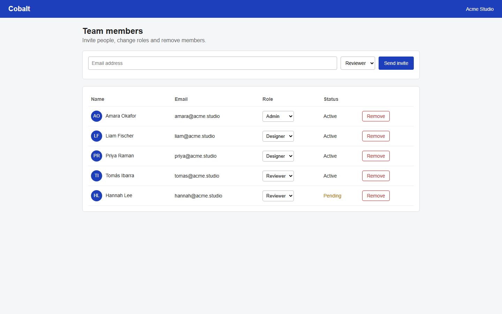
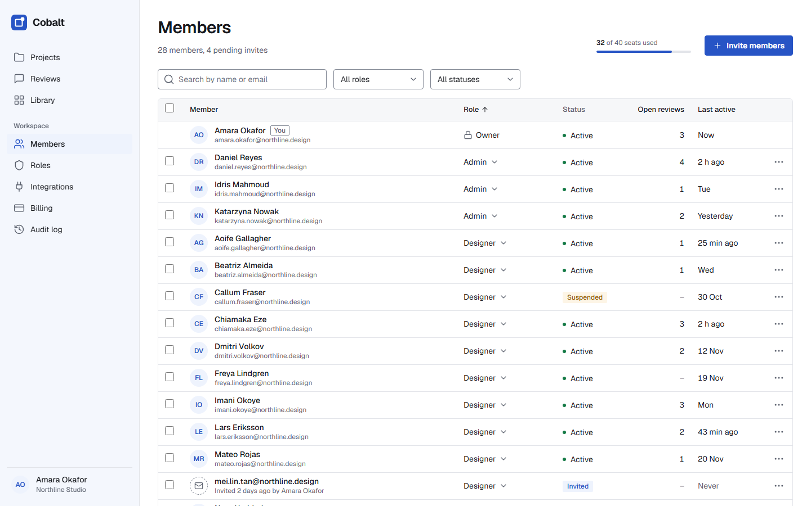
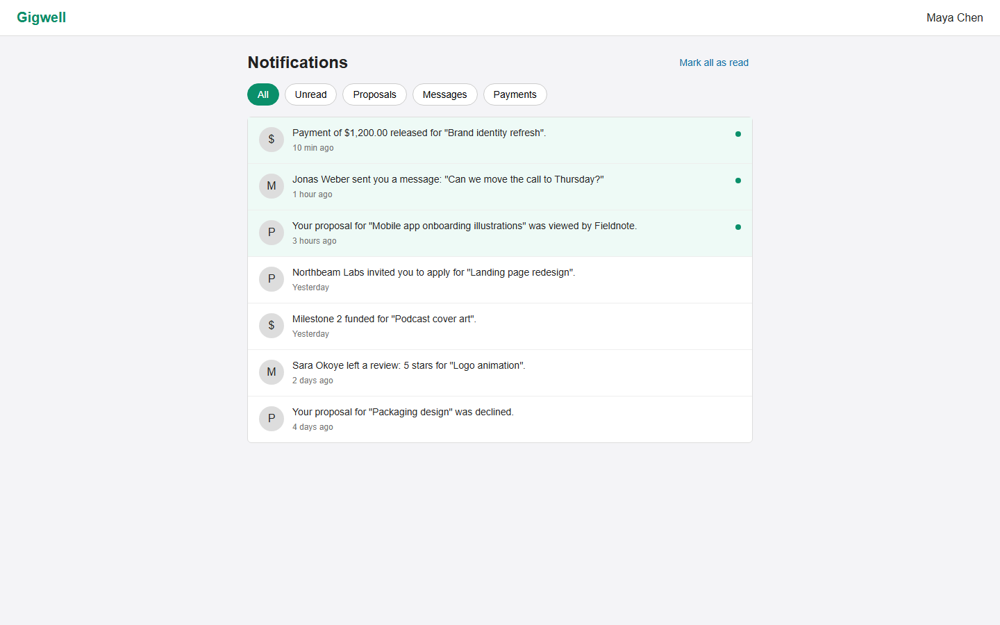
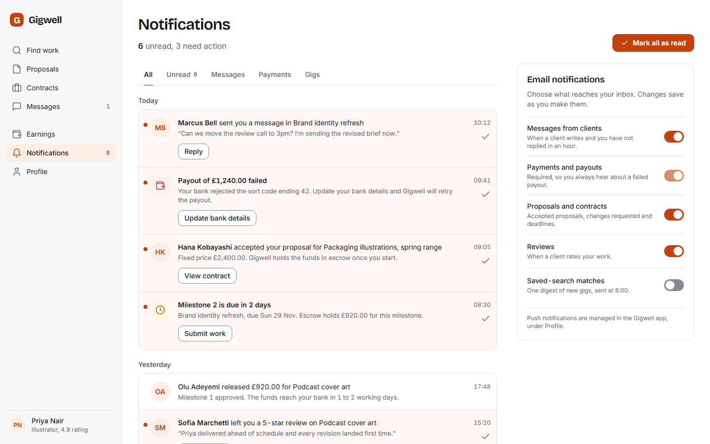
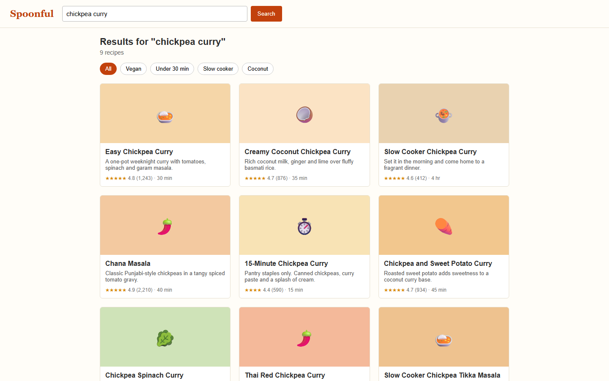
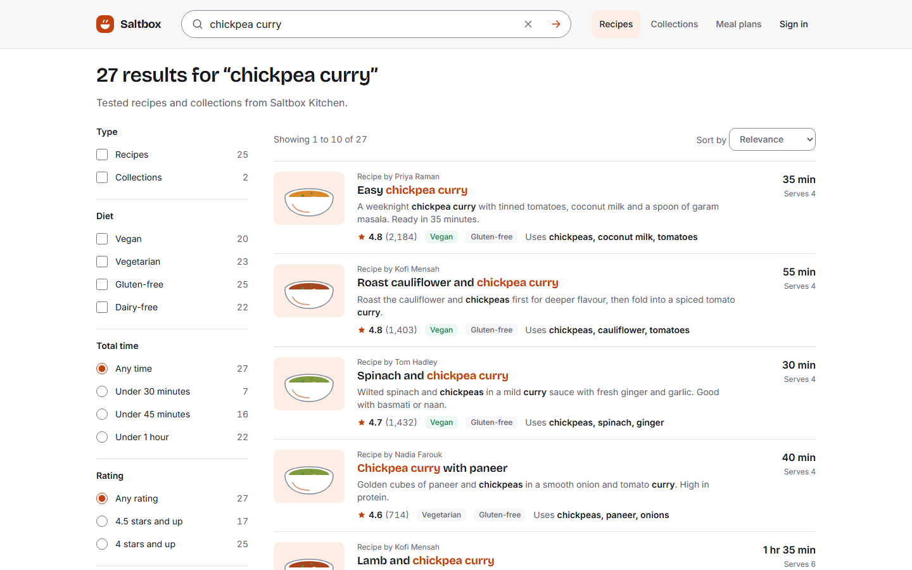
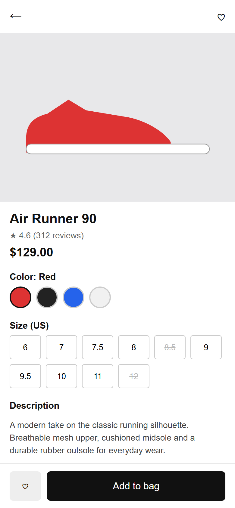
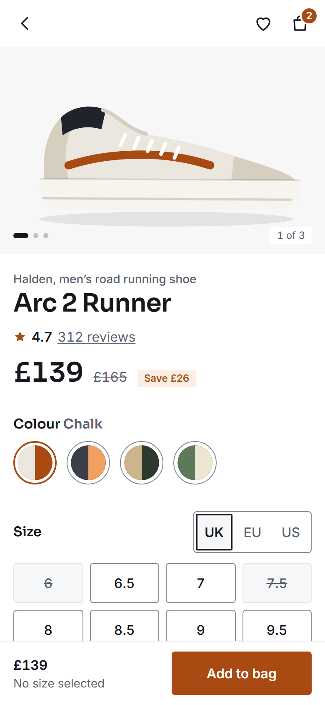

A blind screenshot eval shows this design skill beat Anthropic's frontend-design skill on 3 of 4 tasks its author never saw.

`everyday-ui` is a skill for building everyday product screens: settings, tables, dashboards, sign-in, checkout and similar. It lives in `skill/everyday-ui`. The rest of the repo is the eval harness and the evidence.

## Result

Held-out round, skill v4. Four tasks the skill author never saw. Four blind judges each scored every task. Scores run from 1 to 10.

| arm | light mean | overall |
| --- | --- | --- |
| `skill` (everyday-ui) | 8.03 | 7.88 |
| `anthropic` (frontend-design skill) | 7.22 | 6.75 |
| `prompt` (a strong "senior product designer" instruction) | 6.31 | 5.81 |
| `baseline` (no instructions) | 4.06 | 3.38 |

`skill` won 3 tasks and tied 1 (search results, with `anthropic`). Light mean is the mean of all criteria except dark mode. The scores come from `runs/final/results.md`.

This is one sample per arm per task, scored by Claude judges. Read [Caveats](#caveats) before you quote the numbers.

## Before and after

Left is `baseline`, right is `skill`. Same prompt, same generator (Claude Sonnet 5.5). Judges saw these screenshots without arm names.

**09 team members** (desktop fold)

<table><tr>
<td></td>
<td></td>
</tr></table>

**10 notifications** (desktop fold)

<table><tr>
<td></td>
<td></td>
</tr></table>

**11 search results** (desktop fold)

<table><tr>
<td></td>
<td></td>
</tr></table>

**12 mobile product** (phone fold, 390 px wide)

<table><tr>
<td></td>
<td></td>
</tr></table>

All four arms, both widths and the losses are on the proof page: `proof/index.html`. Open it from a clone, because it links to `runs/`. `proof/proof-standalone.html` is the same page with the images inlined, for viewers that cannot load local files. `node scripts/inline-proof.mjs` regenerates it.

## Install the skill

Copy `skill/everyday-ui` into `~/.claude/skills/` for every project, or into `.claude/skills/` inside one project.

```
cp -r skill/everyday-ui ~/.claude/skills/
```

The skill ships a checker, `skill/everyday-ui/scripts/ui-check.mjs`. It needs Playwright and a browser:

```
npm install playwright
npx playwright install chromium
```

The checker finds Playwright in the page's project, the current project, beside the script or in the global npm root. If it finds none, it prints the install command.

## How it works

`SKILL.md` gives nine steps. Each step ends with an exit check.

1. Read the ground: tokens, components, icon set, font, logo and output contract.
2. Write a brief: screen, product, signature, user, job, one primary action, data and must states.
3. Load one to three pattern files and write the regions for 1440 px and 390 px.
4. Pick brand, type scale and tokens. Build the mark. Adopt the project's tokens when they exist.
5. Build coherent fixtures. Hostile data lives only behind `?state=stress`.
6. Build in order: structure, shell, default view, must states, phone, dark mode.
7. Run `ui-check.mjs` for screenshots and code checks. Fix every FAIL.
8. Look at the screenshots, including a blurred squint shot. Score a 15-point checklist. Fix the worst defects.
9. Remove one element, re-check each state and report known gaps.

## Design references

The skill works without any paid source. It falls back to 17 built-in pattern files in `skill/everyday-ui/references/patterns/`. They draw on GOV.UK, Primer, Polaris, Atlassian, Baymard and NN/g.

If Mobbin or Refero is connected, the skill reads 2 or 3 reference screens for structure, density, states and copy. It never copies pixels. Mobbin has an official MCP at `api.mobbin.com/mcp` on its Pro plan. Its terms ban scraping and driving a signed-in browser, so the skill does neither. Refero also has an MCP. Notes are in `docs/research/research-references.md`.

## The curve

Light mean on the 8 development tasks (`evals/tasks`). Only the `skill` arm changed between rounds. The other three arms were generated once and reused.

| skill version | round | `skill` | `anthropic` | `prompt` | `baseline` | task wins for `skill` |
| --- | --- | --- | --- | --- | --- | --- |
| v1 | r0 | 7.28 | 7.54 | 6.60 | 6.97 | 3 of 8 |
| v2 | r1 | 7.64 | 7.43 | 6.59 | 6.89 | 5 of 8 |
| v3 | r2 | 7.60 | 7.27 | 6.74 | 6.59 | 4 of 8 |
| v4 | r3 | 7.89 | 7.39 | 6.64 | 6.50 | 7 of 8 |

v1 lost to `anthropic` on light-mode quality. It overcorrected into a bland, unbranded look. The next three versions fixed that. [docs/LESSONS.md](docs/LESSONS.md) says which changes moved scores and which did not.

## Caveats

- Judge noise is about 0.5 per round. The unchanged `anthropic` pages scored 6.38 to 6.94 overall across four rounds.
- One sample per arm per task. A second generation could look different.
- All judges are Claude models, the same family as the generator.
- The `anthropic` arm's agent also screenshotted its own pages.
- The prompts did not ask for dark mode, so dark mode is scored apart from the light mean.
- On 12-mobile-product, judge notes say the `anthropic` page scrolls inside a frame, so its full-page shot hid content. This may understate `anthropic` there.
- No human has judged these pages yet.
- The skill still trails on typography in r3 (7.50 against 7.75). It lost sign-in in r3 (6.0 against 8.0).

[docs/METHOD.md](docs/METHOD.md) has the full list and what would make the proof stronger.

## Reproduce

Generators write `runs/<round>/<condition>/<task>/index.html` under the contract in `evals/RULES.md`. The scripts do the rest. Run them from the repo root.

```
npm install
npx playwright install chromium
node scripts/shoot.mjs runs/final
node scripts/lint.mjs runs/final
node scripts/blind.mjs runs/final baseline prompt anthropic skill --seed 101
node scripts/judge-kit.mjs runs/final
node scripts/unblind.mjs runs/final
node scripts/report.mjs
```

- `shoot` writes five screenshots per page. `lint` writes `lint.json` per page and `lint-summary.md`.
- `blind` copies the screenshots under shuffled labels into `runs/final/blind/` and writes `blind-key.json`.
- Run `judge-kit` after `blind`. Give each judge agent only `blind/JUDGE.md`. Each judge writes `blind/scores-<name>.json`.
- `blind` wipes `blind/`, including any judge scores. Run it once per round.
- `unblind` writes `scores.json` and `results.md`. `report` writes `report/index.html`.

## Repo map

| Path | What it holds |
| --- | --- |
| `skill/everyday-ui/` | The skill: `SKILL.md`, 17 pattern files, references and `scripts/ui-check.mjs`. |
| `evals/RULES.md` | The output contract every generator follows. |
| `evals/tasks/` | Development tasks 01 to 08. The skill author saw these. |
| `evals/heldout/` | Held-out tasks 09 to 12. The skill author never saw these. |
| `scripts/` | `shoot`, `lint`, `blind`, `judge-kit`, `unblind`, `report` and shared `lib.mjs`. |
| `runs/r0` to `runs/r3` | Four rounds on tasks 01 to 08, one folder per arm and task. |
| `runs/final/` | The held-out round on tasks 09 to 12. |
| `docs/METHOD.md` | The eval design, round by round, with every caveat. |
| `docs/LESSONS.md` | What moved scores and what did not. |
| `docs/research/` | Notes written before the skill: gap analysis, techniques, references. |
| `proof/index.html` | A static page with the charts, the gallery and the losses. |
