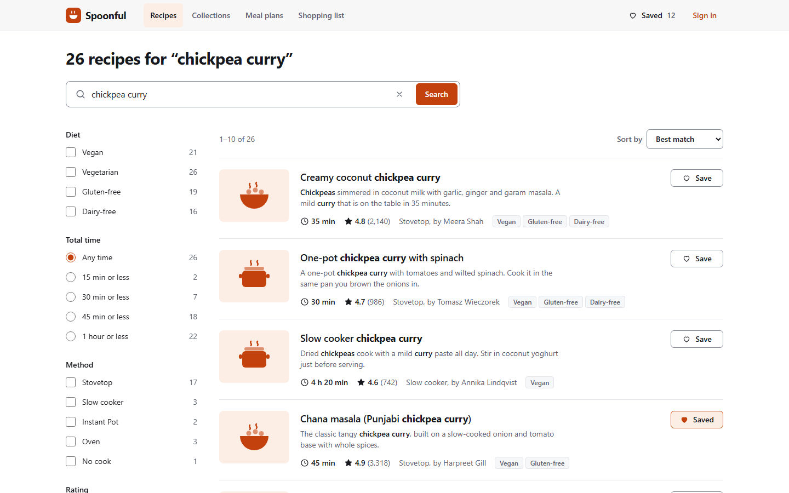
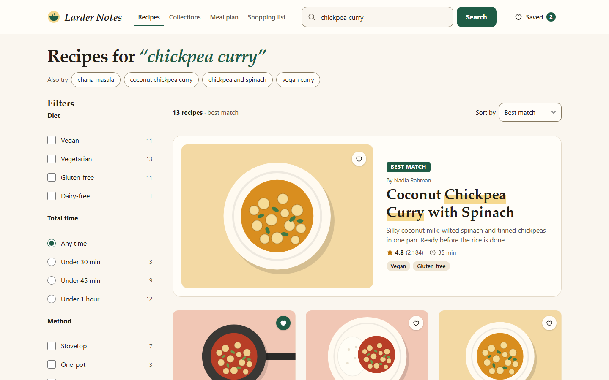
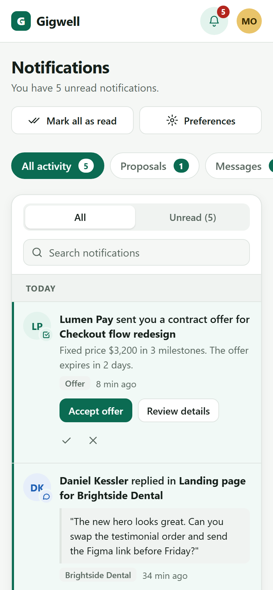
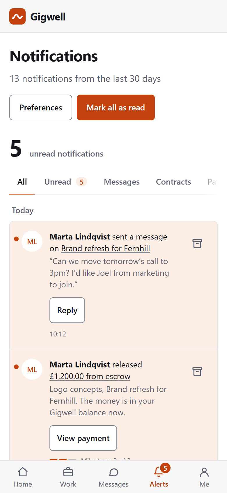

# everyday-ui

**The skill lost its pre-registered test.** In round `proof2`, blind judges scored skill v4 below Anthropic's frontend-design skill and below a plain designer prompt.

- `skill` minus `anthropic`: -0.98 light-mean points, 95% CI [-1.37, -0.50].
- `skill` minus `prompt`: -1.38, 95% CI [-1.72, -1.05].
- `skill` minus `baseline` (no instructions): +0.22, 95% CI [-0.41, +0.83]. That interval includes 0.
- The skill had the top score in 0 of 24 groups.

The pre-registered hypothesis H1 said the skill beats `anthropic`. The data reject it, in the opposite direction. An earlier version of this page claimed a win on 3 of 4 held-out tasks. That claim is superseded. See [History](#history-superseded).

The skill still leads on mechanical quality: no serious accessibility failures and almost no small tap targets. The judges did not rank pages by that.

## What this repo is

`everyday-ui` is a Claude Code skill for everyday product screens: settings, tables, dashboards, sign-in, checkout and similar. It lives in `skill/everyday-ui`. The rest of the repo is the eval harness and every page, screenshot and score behind the numbers.

## Round proof2

I wrote the plan in [docs/PREREG.md](docs/PREREG.md) and committed it before any page existed. The design:

- 8 held-out tasks (09 to 16), 4 arms, 3 samples each: 96 pages. A fresh Claude Sonnet 5.5 agent built each page.
- The arm briefs are frozen in `evals/arms/`. The `prompt`, `anthropic` and `skill` arms got the same screenshot tool, `scripts/peek.mjs`. `baseline` got none.
- 4 blind judges per task: 2 Opus 5.5 and 2 Sonnet 5.5. A new judge rule said: do not reward a page for holding more content.
- `scripts/stats.mjs` computes every number. It was committed with the plan and has not changed since.

| arm | what the generator got | light mean | `skill` minus this arm [95% CI] |
| --- | --- | --- | --- |
| `prompt` | a "senior product designer" instruction | 7.80 | -1.38 [-1.72, -1.05] |
| `anthropic` | Anthropic's frontend-design skill | 7.39 | -0.98 [-1.37, -0.50] |
| `skill` | this repo's skill, v4 | 6.42 | |
| `baseline` | the task only | 6.19 | +0.22 [-0.41, +0.83] |

Light mean is the mean of every criterion except dark mode, `overall` included. Both judge families agree on the sign. `skill` minus `anthropic` is -0.72 [-1.15, -0.20] for the Opus judges and -1.24 [-1.62, -0.78] for the Sonnet judges.

Light mean per task, averaged over three samples (ranges in `runs/proof2/stats.md`):

| task | `baseline` | `prompt` | `anthropic` | `skill` |
| --- | --- | --- | --- | --- |
| 09 team members | 5.53 | 7.92 | 7.44 | 6.63 |
| 10 notifications | 6.22 | 7.71 | 7.80 | 6.45 |
| 11 search results | 6.69 | 7.95 | 7.08 | 5.77 |
| 12 mobile product | 6.27 | 8.13 | 7.23 | 6.63 |
| 13 expense report | 7.09 | 7.31 | 7.49 | 6.13 |
| 14 support conversation | 5.93 | 8.15 | 6.97 | 7.30 |
| 15 mobile booking | 5.34 | 7.57 | 7.66 | 6.41 |
| 16 stock levels | 6.48 | 7.67 | 7.48 | 6.00 |

I checked the pipeline twice. All 96 blind label images match their source pages by md5. Arm means recomputed from the 32 raw judge files match `stats.json`.

## Where the skill still leads

The lint (`scripts/lint.mjs`) measures each page in a real browser, without judges. Per-page means over 24 pages per arm:

| check | `baseline` | `prompt` | `anthropic` | `skill` |
| --- | --- | --- | --- | --- |
| Axe serious + critical nodes | 2.67 | 1.50 | 3.71 | 0.00 |
| Contrast failures | 2.13 | 0.00 | 1.79 | 0.00 |
| Tap targets under 44 px at 390 px | 26.6 | 28.4 | 19.7 | 0.9 |
| Pages that scroll sideways at 390 px (count) | 3 | 0 | 0 | 0 |

The judges still scored the skill's phone screens lower: mobile quality 6.21, against 7.17 for `prompt`.

## What the loss looks like

**11 search results, sample 1** (desktop first screen). Left `skill`, light mean 6.09. Right `prompt`, 7.72. All four judges named the same flaw on the skill page: every thumbnail is the same flat icon.

<table><tr>
<td></td>
<td></td>
</tr></table>

**10 notifications, sample 2** (phone first screen). Left `baseline`: 54 tap targets under 44 px, and the page scrolls 404 px sideways. Right `skill`: 0 and 0. The judges still scored `baseline` higher, 6.53 against 6.06.

<table><tr>
<td></td>
<td></td>
</tr></table>

All four arms for three groups are on the proof page, `proof/index.html`. Open it from a clone, because it links to `runs/`. `proof/proof-standalone.html` has the images inlined. `node scripts/inline-proof.mjs` rebuilds it.

## Why it lost (interpretation, not proven)

- `prompt` got the screenshot tool for the first time. On the same tasks 09 to 12 it rose from 6.31 to 7.92 and passed `anthropic` (7.39). The earlier win likely came mostly from the skill's look loop, not its rules.
- On those same four tasks the frozen skill fell from 8.03 to 6.37. The no-more-content rule may have removed a volume advantage (caveat 9 in [docs/METHOD.md](docs/METHOD.md)).
- `baseline` also rose on those tasks, from 4.06 to 6.18, with no new tool. Absolute levels move between rounds, so read these shifts with care.
- Recurring judge notes on skill pages: primary buttons look enabled before a required choice. The primary job is buried on phones. Dead gaps. Identical repeated icons. Plain, low-brand visuals next to illustrated competitors.

## Known run issues

- One skill sample, 12 mobile product sample 1, did not run the skill's checker. It is scored, because the plan forbids dropping pages.
- Generator agents may have run with a user-level "ponytail" (minimal-code) output style. One agent report mentions it. It would apply to all arms equally.
- Generators were told not to use the Skill tool. The skill arm read `SKILL.md` as a file instead.

## Next

Skill v5 is being built from the `proof2` judge notes. It will run as round `proof3` on 4 new held-out tasks, under a new pre-registration. This page will report that result whichever way it falls.

## History (superseded)

These rounds came before `proof2`. Each used one sample per arm per task and no pre-registration. Only `skill` and `anthropic` are known to have looked at their own pages. Their headline did not hold. Final round, held-out tasks 09 to 12, skill v4 (`runs/final/results.md`):

| arm | light mean | overall |
| --- | --- | --- |
| `skill` | 8.03 | 7.88 |
| `anthropic` | 7.22 | 6.75 |
| `prompt` | 6.31 | 5.81 |
| `baseline` | 4.06 | 3.38 |

The earlier claim was "skill won 3 tasks and tied 1". `proof2` re-ran these four tasks with three samples and the skill scored lowest of the three instructed arms on each.

Development curve on tasks 01 to 08. The skill author tuned on these tasks. Only the `skill` arm changed between rounds. [docs/LESSONS.md](docs/LESSONS.md) says what moved these scores, and what `proof2` changed about those lessons.

| skill version | round | `skill` | `anthropic` | `prompt` | `baseline` | task wins for `skill` |
| --- | --- | --- | --- | --- | --- | --- |
| v1 | r0 | 7.28 | 7.54 | 6.60 | 6.97 | 3 of 8 |
| v2 | r1 | 7.64 | 7.43 | 6.59 | 6.89 | 5 of 8 |
| v3 | r2 | 7.60 | 7.27 | 6.74 | 6.59 | 4 of 8 |
| v4 | r3 | 7.89 | 7.39 | 6.64 | 6.50 | 7 of 8 |

## Install the skill

Copy `skill/everyday-ui` into `~/.claude/skills/` for every project, or into `.claude/skills/` inside one project.

```
cp -r skill/everyday-ui ~/.claude/skills/
```

The checker, `skill/everyday-ui/scripts/ui-check.mjs`, needs Playwright and a browser: `npm install playwright` and `npx playwright install chromium`. It prints the install command if it finds no Playwright.

## How the skill works

`SKILL.md` gives nine steps, each with an exit check: read the ground, write a brief, load pattern files, pick brand and tokens, build fixtures, build, run `ui-check.mjs`, look at the screenshots and score a checklist, then remove one element and report gaps. It falls back to 17 pattern files in `skill/everyday-ui/references/patterns/`. If Mobbin or Refero is connected, it reads 2 or 3 reference screens and never copies pixels.

## Caveats

- Every judge is a Claude model, the same family as the generator. No human has judged these pages.
- Judges see screenshots only. They cannot test behaviour, keyboard flow or screen readers.
- Eight tasks is a small set, and the task choice may favour one arm. A blind label hides the arm name, not the style.
- `baseline` gets no look tool by design. Its gap to the other arms mixes instructions with the ability to see the page.

[docs/METHOD.md](docs/METHOD.md) has the full design, the `proof2` checks and what would make the proof stronger.

## Reproduce

Generators write `runs/<round>/<arm>/<task>-s<n>/index.html` from the briefs in `evals/arms/`. Run the rest from the repo root:

```
npm install
npx playwright install chromium
node scripts/shoot.mjs runs/proof2
node scripts/lint.mjs runs/proof2
node scripts/blind.mjs runs/proof2 baseline prompt anthropic skill --seed 2026
node scripts/judge-kit.mjs runs/proof2 --per-task
node scripts/unblind.mjs runs/proof2
node scripts/stats.mjs runs/proof2
```

- Give each judge agent only its `blind/JUDGE-<task>.md`. Name judges `opus<...>` or `sonnet<...>`.
- `blind` wipes `blind/`, judge scores included. Run it once per round. `stats` writes `stats.json` and `stats.md`.

## Repo map

| Path | What it holds |
| --- | --- |
| `skill/everyday-ui/` | The skill: `SKILL.md`, 17 pattern files, references and `scripts/ui-check.mjs`. |
| `evals/RULES.md`, `evals/arms/` | The output contract and the frozen arm briefs. |
| `evals/tasks/`, `evals/heldout/` | Development tasks 01 to 08, and held-out tasks 09 and up. |
| `scripts/` | `shoot`, `lint`, `blind`, `judge-kit`, `unblind`, `stats`, `peek`, `report`, `inline-proof`. |
| `runs/proof2/` | The pre-registered round: pages, screenshots, blind kit, scores and stats. |
| `runs/r0` to `runs/r3`, `runs/final/` | Earlier rounds, superseded. |
| `docs/PREREG.md`, `docs/METHOD.md`, `docs/LESSONS.md` | The plan, the full method and what moved scores. |
| `proof/index.html` | A static page with the numbers, the galleries and the losses. |
